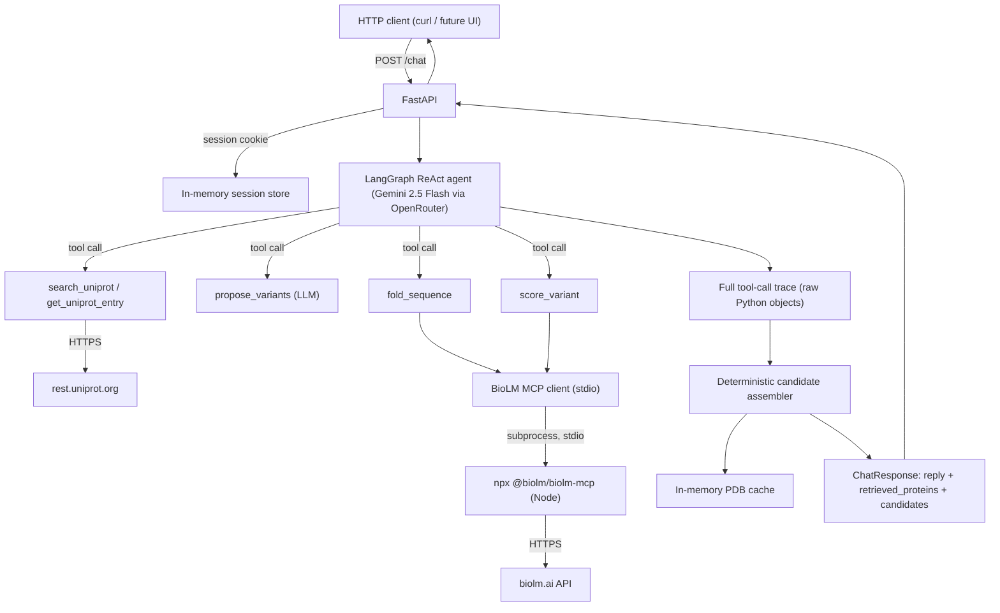

# ProtDAP Architecture

## Locked design decisions

- **Core agent pattern**: ReAct, implemented with `langgraph.prebuilt.create_react_agent`
  (a modern, tool-calling ReAct loop - more reliable than legacy text-parsed
  ReAct, and works cleanly with OpenRouter's OpenAI-compatible tool-calling API).
- **LLM**: OpenRouter, model `google/gemini-2.5-flash`, via `langchain-openai`'s
  `ChatOpenAI` pointed at `https://openrouter.ai/api/v1`.
- **Search backend**: the UniProt REST API (`https://rest.uniprot.org`),
  free and keyless. No Elasticsearch, no OpenAI text embeddings - UniProt
  *is* the protein knowledge base.
- **Structure/scoring backend**: a real BioLM MCP client, spawning
  `npx -y @biolm/biolm-mcp` as a Node subprocess over stdio via the official
  Python `mcp` SDK. Tool names used: `predict_v3_esmfold` (fold) and
  `predict_v3_esm1v_all` (variant scoring, best-effort). A **fresh
  connection is opened per call** rather than one shared/persisted
  connection - see "Reliability design" below for why.
- **Sequence generation (v1)**: LLM-based `propose_variants`. Every
  generated sequence is labeled `origin=llm_proposed` and is never presented
  as a validated design. See "Future work" below for the planned upgrade.
- **pLDDT** (from ESMFold) is a **filter/report signal only**, never proof
  of function.
- **Session memory**: cookie-based, in-memory (dict keyed by session id,
  TTL-based cleanup).
- **No Postgres / external DB**: UniProt is the protein DB, BioLM is the
  model backend, sessions and the PDB cache are in-memory only.

## Architecture diagram



## Reliability design: trace-based assembly, not LLM-parsed JSON

The ReAct agent's own prose is only ever used for the natural-language
`reply` field. The structured `candidates` / `retrieved_proteins` lists are
**not** parsed from the LLM's text output - they are deterministically
assembled in Python (`app/agent/assembler.py`) from a **tool-call trace**:
every `search_uniprot` / `get_uniprot_entry` / `propose_variants` /
`fold_sequence` / `score_variant` call made during the turn, together with
its *raw Python return value* (not a re-serialized string the model saw).

Concretely (`app/agent/graph.py`): each LangChain tool wrapper appends
`{"tool": name, "args": {...}, "result": <raw object>}` to a trace list
that is private to that one request, in addition to returning a
JSON string to the LLM as normal tool output. The assembler then:

1. Collects every `search_uniprot`/`get_uniprot_entry` result into
   `retrieved_proteins`, deduplicated by accession.
2. For every `propose_variants` call, matches each proposed sequence
   against any `fold_sequence`/`score_variant` trace entries with the exact
   same sequence string, and against the retrieved-protein list to recover
   the parent's accession/organism metadata.
3. Computes `identity_to_parent` via `app/tools/identity.py` (Biopython
   global pairwise alignment) in code - never asks the LLM for a number.

This guarantees the provenance schema is always internally consistent
regardless of what the agent's reasoning/prose says.

**A real bug this surfaced**: the first implementation kept one long-lived
BioLM MCP connection open for the whole app process and reused it across
calls. Live testing showed this fails intermittently with
`RuntimeError: Attempted to exit cancel scope in a different task than it
was entered in` - `mcp`'s stdio transport is built on `anyio` task groups,
whose cancel scopes are pinned to the specific `asyncio.Task` that entered
them, but LangGraph's `ToolNode` dispatches each tool call as its own task.
The fix (`app/tools/biolm_mcp.py`) opens and fully tears down a fresh
connection inside a single `async with` block for every `fold_sequence`/
`score_variant` call, so the connection's whole lifecycle stays within one
task. The trade-off is a few extra seconds of `npx` startup latency per
fold/score call, which is acceptable since these aren't hot-path calls.

## Candidate schema

```json
{
  "sequence": "MEK...",
  "origin": "retrieved | llm_proposed",
  "parent": {
    "accession": "P12345",
    "protein_name": "...",
    "organism": "...",
    "sequence": "..."
  },
  "identity_to_parent": 0.87,
  "method": "retrieved | llm_propose",
  "model_version": "google/gemini-2.5-flash | n/a",
  "structure": {
    "available": true,
    "mean_plddt": 72.4,
    "model_source": "BioLM ESMFold",
    "structure_id": "..."
  },
  "esm1v_score": null,
  "warnings": []
}
```

Rules enforced in code (not just prompted):

- `origin=llm_proposed` candidates always carry a non-null `parent` and a
  computed `identity_to_parent`.
- If a proposed candidate was never folded, or folding failed,
  `structure.available=false` and `warnings` includes
  `"fold_failed_or_skipped"`.
- If the LLM proposed variants from a "parent" sequence that was never
  actually returned by `search_uniprot`/`get_uniprot_entry` in this turn
  (i.e. it wasn't a real retrieved protein), `warnings` includes
  `"parent_sequence_not_found_in_retrieved_proteins"` and `parent.accession`
  / `parent.organism` are left `null`.
- The schema also supports `origin=retrieved` (with `identity_to_parent=1.0`,
  `method="retrieved"`) for future use cases where a known protein should be
  presented alongside designed candidates for direct comparison; v1's
  assembler does not currently populate this path on its own (a pure search
  turn returns an empty `candidates` list, not the hits-as-candidates).

## `POST /chat` contract

Request: `{"message": "..."}` (session id via an httponly cookie, created
on first request).

Response:
```json
{
  "reply": "...",
  "retrieved_proteins": [...],
  "candidates": [...],
  "tool_trace_summary": ["search_uniprot(text='...') -> 3 hit(s)", "..."]
}
```

`GET /structures/{structure_id}` returns the raw PDB text (from the
in-memory structure cache) for downstream 3D visualization (e.g. Mol*).

`POST /fold` (`{"sequence": "...", "name": "..."}` -> `StructureInfo`) is a
stateless, session-independent fold: it calls the same
`BioLMMCPClient.fold_sequence` used inside the agent's `fold_sequence`
tool, storing the resulting PDB in the same structure cache (so the
returned `structure_id` also works with `GET /structures/{id}`), but it is
not tied to a conversation, not added to any `retrieved_proteins`/
`candidates` list, and does not go through the LLM at all. It exists so the
frontend can let a user fold an arbitrary retrieved protein on demand
(a plain button click) without a chat round-trip. `sequence` is validated
to be at least 10 residues of valid amino acid letters before it is sent to
BioLM (`400` otherwise).

`GET /liveness` reports the result of the most recent BioLM MCP
connectivity check (a one-off connect/handshake/close, not a persisted
connection - see the note below).

## Future work

### ProteinMPNN as the planned next generation method

**ProteinMPNN is the planned next generation method**, to be added
*beside* `llm_proposed` (not replacing it) once a parent structure is
available (from AlphaFold DB or a `fold_sequence` call). It would appear as
a new `method="proteinmpnn"`, `origin="model_generated"` value in the
existing candidate schema above - **no schema changes required**, since
`method` / `model_version` / `origin` are already generic string/enum
fields designed to accommodate new generation backends.

**RFdiffusion is explicitly out of scope** for this project's "diversify an
existing protein while preserving function" framing, and is deferred
indefinitely unless the thesis direction later shifts toward de novo /
binder design.

### Other deferred items

- A real protein-language-model semantic search (embedding UniProt
  sequences with ESM and doing nearest-neighbor search) instead of
  UniProt's own keyword/field search - out of scope for this minimal
  refactor, but would slot in as an additional `search_uniprot_semantic`
  tool without touching the rest of the pipeline.
- Persisting sessions/results somewhere durable (Postgres or similar) if
  this moves beyond a single-process prototype.

## Frontend

A React + Vite + TypeScript + Tailwind panel lives in `frontend/` (see
`frontend/README.md` for setup/run instructions), talking to this
backend's `POST /chat`, `POST /fold`, `GET /structures/{id}`, and
`GET /liveness` endpoints. Highlights:

- Chat transcript in the center; side panels accumulate every
  `retrieved_proteins`/`candidates` entry seen across the whole
  conversation (deduped by `accession`/`sequence`), persisted to
  `localStorage` since the backend only returns the latest turn's data.
- Candidate sequences render with mutated residues inline-highlighted
  (position computed from `Candidate.modifications`, see the schema
  above), plus a Mol* 3D viewer for folded structures.
- Retrieved (non-candidate) proteins get an on-demand "Fold & view 3D
  structure" button that calls `POST /fold` directly - this is
  per-card, client-only state (not part of the conversation store), since
  folding a retrieved protein is a separate action from the chat/agent
  flow and most search hits are never folded.
- In dev, Vite proxies API calls to the backend so the session cookie is
  treated as same-origin; `app/main.py`'s `CORSMiddleware` (allowing
  `config.frontend_origin`, with credentials) covers the case of calling
  the backend directly instead.

## Testing

### UniProt REST tool tests (`app/tools/test_uniprot.py`)

Dedicated, fully offline unit tests for `app/tools/uniprot.py`, independent
of the LLM/agent, using [`respx`](https://lundberg.github.io/respx/) to
mock the `httpx` transport and recorded fixtures under `app/eval/fixtures/`:

1. `search_uniprot("human immune response")` against a recorded fixture
   returns parsed hits with `accession`, `protein_name`, `organism`,
   `sequence` populated - and no raw UniProt JSON keys (e.g.
   `primaryAccession`) leak through.
2. `build_query(..., reviewed=True)` includes `reviewed:true`;
   `reviewed=False` omits it.
3. `build_query(..., organism_id="9606")` ANDs `organism_id:9606` in.
4. `get_uniprot_entry("P69905")` against a recorded fixture returns a
   single entry with a non-empty `sequence`.
5. A mocked HTTP 429 (with `Retry-After`) triggers exactly one retry, then
   succeeds on the second attempt.
6. A second consecutive 429 correctly raises rather than retrying forever.
7. A malformed/empty UniProt response (no `results` key) raises the typed
   `UniProtResponseError`, not a raw `KeyError`.
8. A live-mode variant (only runs when `EVAL_LIVE=1`) makes one real call to
   `https://rest.uniprot.org` to confirm the real API contract still
   matches the fixture shape used above.

Run with: `pytest app/tools/test_uniprot.py -v`.

### Smoke eval (`app/eval/smoke_eval.py`)

An integration-level eval that exercises the **real ReAct agent loop**
(real OpenRouter LLM calls - by design, since that reasoning loop is the
thing actually being tested), with UniProt/BioLM tool calls swapped for
recorded fixtures when `EVAL_LIVE=0` (default) so it doesn't need a BioLM
token or hit UniProt's live API. Five fixed cases:

1. *"Find human proteins involved in immune response."* - a pure search
   request: `retrieved_proteins` has >=1 hit, `candidates` is empty, and
   `propose_variants` was never called.
2. *"Find a small human protein and propose 3 more stable variants."* -
   `candidates` is non-empty and <=5, every candidate has
   `origin=llm_proposed`, a non-null `parent`, `identity_to_parent` in
   `(0, 1]`, and a sequence matching `^[ACDEFGHIKLMNPQRSTVWY]+$`.
3. Reusing case 2's run: at least one candidate has
   `structure.available=true` with a numeric `mean_plddt`, OR its
   `warnings` explain the failure - and the reply text never claims proven
   function (checked against a forbidden-phrase list).
4. An unqualified search ("Find proteins involved in immune response.")
   returns more than a single hit (the `DEFAULT_RESULT_SIZE` fix).
5. A mocked UniProt 429-then-200 sequence (via `respx`, no agent involved)
   results in a successful retried call, not a failure.

The script prints a pass/fail table and exits non-zero if any case fails.
Any unexpected exception (e.g. an invalid API key) is caught per-case and
reported as a normal FAIL row rather than crashing the whole run.
