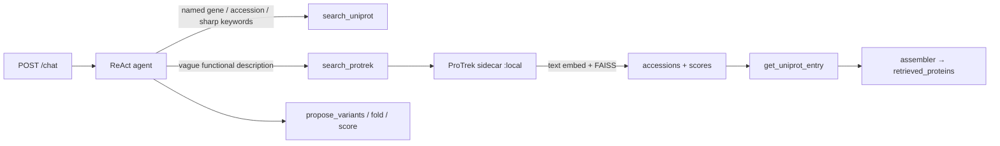

# ProTrek semantic search for ProtDAP

Plan for adding **text→protein** semantic search alongside UniProt keyword
search. Work through this on a **GPU machine**; ProTrek_650M is heavy at
query time.

**Status:** planning only — not implemented in ProtDAP yet.

**Primary user story:** describe a protein in natural language → find a real
UniProt parent → diversify (existing LLM + BioLM fold/score path).

**Related reading:** [ARCHITECTURE.md](ARCHITECTURE.md), [TOOLS.md](TOOLS.md),
[README.md](README.md).

---

## Decision summary

| Option | Verdict for “describe → find” |
| --- | --- |
| UniProt keyword (`search_uniprot`) | Keep as baseline (API-only) |
| UniProt ProtT5 H5 → FAISS | **Wrong tool** — embeds **sequence only** |
| DPEB | Skip — human-only ML dump, not text retrieval |
| **ProTrek_650M + Swiss-Prot FAISS** | **Chosen** — text↔sequence in one space |

**Thesis framing**

1. Baseline: UniProt keyword retrieval  
2. Novel: ProTrek text→protein semantic retrieval  
3. Then: diversification (LLM propose + BioLM fold/score) on chosen parent  

Cite: Su et al., *Nature Biotechnology* 2025 — [paper](https://www.nature.com/articles/s41587-025-02836-0),
[repo](https://github.com/westlake-repl/ProTrek), online demo [search-protrek.com](http://search-protrek.com/).

---

## What ProTrek_650M embeds

Three modalities → **one shared ~1024-d space** (contrastive alignment of
sequence ↔ structure ↔ text/function):

| Modality | Encoder (650M package) | What goes in |
| --- | --- | --- |
| **Sequence** | ESM-2 650M backbone | Amino acid string |
| **Structure** | Foldseek 150M | Foldseek structural sequence (from PDB/CIF via `foldseek`) |
| **Text / function** | PubMedBERT (~130M) | Natural-language description (function, role, etc.) |

Unlike UniProt ProtT5 (sequence only), ProTrek **does** embed function — as
**text**, in a space trained to match sequence/structure.

### Query mode for ProtDAP MVP

**Description → protein** = **text → sequence FAISS index**:

1. Embed the description with `get_text_repr(...)`  
2. Search the precomputed **sequence** FAISS index (Swiss-Prot proteins
   embedded with the sequence encoder)  
3. Top hits = proteins whose sequence vectors are close to the text vector  

Other modes (later): sequence→sequence, structure→structure, text→structure,
etc.

**Critical:** description queries **must** use ProTrek’s text encoder — not
OpenAI embeddings, not ProtT5, not BioLM ESM.

---

## Architecture (sidecar, not in-process)

ProTrek’s deps (torch, their model code, FAISS, Foldseek) should **not** be
mixed into ProtDAP’s FastAPI process.

```text
User → ProtDAP agent → search_protrek tool → HTTP to local ProTrek sidecar
                                         → accessions + scores
                                         → get_uniprot_entry for full ProteinHit
```

Keep existing UniProt keyword search unchanged.



---

## GPU machine: stand up ProTrek locally

Follow [ProTrek README](https://github.com/westlake-repl/ProTrek) roughly.

### 1. Environment

```bash
git clone https://github.com/westlake-repl/ProTrek.git
cd ProTrek
conda create -n protrek python=3.10 --yes
conda activate protrek
bash environment.sh
```

### 2. Model weights

```bash
huggingface-cli download westlake-repl/ProTrek_650M \
  --repo-type model \
  --local-dir weights/ProTrek_650M
```

If Hugging Face is blocked:

```bash
export HF_ENDPOINT=https://hf-mirror.com
```

### 3. Foldseek binary

Needed for structure modality / full demo. For pure **describe → find**, you
mainly need the **text encoder + sequence FAISS**; Foldseek is still required
by their full demo pipeline — download per their README into `bin/foldseek`
and `chmod +x bin/foldseek`.

### 4. FAISS indices (Swiss-Prot is enough)

```bash
huggingface-cli download westlake-repl/faiss_index \
  --repo-type dataset \
  --local-dir faiss_index/
```

Expect paths like:

```text
faiss_index/SwissProt/ProTrek_650M/sequence/
```

(and text/structure subsections). **Do not** pull billion-scale metagenomic
indices for ProtDAP.

Also useful: [function embeddings / descriptions](https://huggingface.co/datasets/westlake-repl/faiss_index/tree/main/SwissProt/ProTrek_650M_UniRef50/text/subsections/),
[billion-scale embedding storage](https://protrek.westlake.edu.cn/) (optional; not needed for MVP).

### 5. Smoke-test

```bash
# Full Gradio demo (ports 7860–7863 must be free)
python demo/run_pipeline.py
# Visit http://127.0.0.1:7860/
```

Or run their embedding example (`get_text_repr` / `get_protein_repr`) from the
README and confirm a text query returns sensible Swiss-Prot neighbors.

**Hardware:** GPU strongly preferred for ProTrek_650M at query time. Indices
are precomputed; queries still need the model.

---

## Sidecar HTTP wrapper (MVP target)

Thin service (their demo, or a small FastAPI around the model + FAISS):

**Request**

```json
{
  "description": "small human cytokine involved in inflammation",
  "k": 5
}
```

**Response (sketch)**

```json
{
  "hits": [
    {"accession": "P05231", "score": 17.84},
    {"accession": "P01584", "score": 16.21}
  ]
}
```

Implementation sketch (from their API):

```python
# Load once at process start
model = ProTrekTrimodalModel(**config).eval().to(device)
# text_embedding = model.get_text_repr([description])  # shape [1, 1024]
# search Swiss-Prot sequence FAISS → top-k ids + scores
```

Config knobs for ProtDAP later: `PROTREK_BASE_URL`, timeout, default `k`.

---

## ProtDAP tool contract

Logical tool name: `search_protrek` (alongside `search_uniprot`).

| Param | Type | Required | Default | Notes |
| --- | --- | --- | --- | --- |
| `description` | `str` | yes | — | Natural-language protein description |
| `k` | `int` | no | `5` | Clamp similarly to UniProt `MAX_RESULT_SIZE` |

**Return (to LLM):** JSON list of hits (accession + score; optionally name if
sidecar returns it).

**Side effects:** HTTP to sidecar; one trace entry; enrich via
`get_uniprot_entry` so assembler can build normal `retrieved_proteins`.

**Provenance / method label (suggested):** `protrek_text`

### Agent prompt rules

- Named gene / accession / sharp keywords → `search_uniprot`  
- Vague functional description → `search_protrek`  
- Then diversify as today (`propose_variants` → fold / score)  

### Assembler

Teach `app/agent/assembler.py` to collect `search_protrek` hits into
`retrieved_proteins` (dedupe by accession), same pattern as `search_uniprot`.

### Wire-up checklist (ProtDAP repo, after sidecar works)

1. `app/tools/protrek.py` — HTTP client to sidecar  
2. `app/agent/graph.py` — register `search_protrek_tool` + trace  
3. `app/agent/assembler.py` — ingest hits  
4. `app/agent/prompts.py` — when to use which search tool  
5. `TOOLS.md` / `ARCHITECTURE.md` — document the tool  
6. `.env.example` — `PROTREK_BASE_URL`  
7. `.gitignore` — never commit weights / FAISS dumps  

---

## MVP order

1. **GPU box:** Local ProTrek + Swiss-Prot sequence FAISS; verify text queries
   return sensible proteins  
2. Thin HTTP wrapper: `{description, k}` → accessions + scores  
3. **ProtDAP:** `search_protrek` tool + assembler + prompt  
4. Optional later: sequence-query mode, organism post-filter via UniProt,
   custom FASTA index via ProTrek `scripts/generate_database.py`

---

## Pitfalls

- Model mismatch: only ProTrek text encoder for description queries  
- Swiss-Prot index only for MVP; skip OMG / GOPC / NCBI-scale dumps  
- Foldseek is for structure; describe→find mainly needs text + sequence FAISS  
- Weights + indices are multi‑GB — gitignore; document download on the GPU host  
- Cite ProTrek paper/repo when using model + indices  
- Do not index LLM-proposed variants into the FAISS DB — natural Swiss-Prot only  

---

## What not to do

- Do **not** replace UniProt with ProTrek — run them side by side  
- Do **not** build UniProt ProtT5→FAISS for this user story (sequence similarity,
  not description search)  
- Do **not** integrate DPEB as the semantic search backend  

---

## Quick links

| Resource | URL |
| --- | --- |
| ProTrek GitHub | https://github.com/westlake-repl/ProTrek |
| Nature Biotech paper | https://www.nature.com/articles/s41587-025-02836-0 |
| Weights (650M) | https://huggingface.co/westlake-repl/ProTrek_650M |
| FAISS index dataset | https://huggingface.co/datasets/westlake-repl/faiss_index |
| Online search demo | http://search-protrek.com/ |
| Embedding storage | https://protrek.westlake.edu.cn/ |
